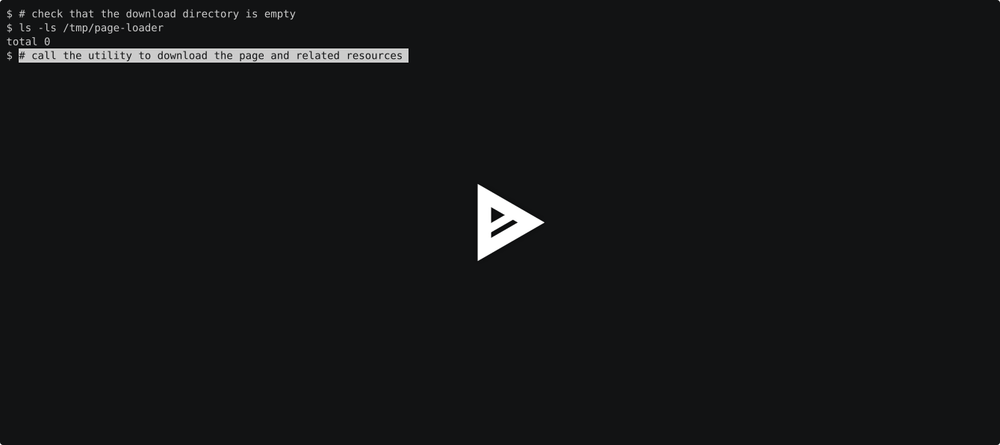

### Hexlet tests and linter status:
[](https://github.com/myxtaridse/js-jest-testing-project-67/actions)

# Тестирование загрузчика страниц (JS)

**«Загрузчик страницы»** - это библиотека и CLI-утилита для скачивания веб-страниц и связанных с ними ресурсов с сохранением на локальном диске. 

Загрузчик получает HTML-разметку страницы, находит ссылки на изображения, таблицы стилей и JavaScript-файлы, скачивает ресурсы и заменяет исходные ссылки в HTML на локальные пути.

Проект повторяет основную функциональность [`js-async-project-4`](https://github.com/myxtaridse/js-async-project-4/), но отличается фокусом разработки: здесь используется **Vitest** вместо Jest, а разработка ведется с применением подхода **TDD (Test-Driven Development)** - написания тестов до реализации функциональности.

## Требования:
- Unix system (Macos/Linux)
- Nodejs 22.x+
- Make

## Описание:
Утилита предоставляет:
- **Загрузка HTML-страниц:** получение содержимого страницы по указанному URL и сохранение его в виде HTML-файла.
- **Загрузка связанных ресурсов:** поиск и скачивание связанных ресурсов страницы - изображений, таблиц стилей и JS-файлов.
- **Локализация ссылок:** замена исходных адресов ресурсов в HTML-разметке на относительные пути к сохраненным файлам.

## Стек

- **JavaScript** - язык программы
- **Node.js** - среда выполнения
- **Axios** - HTTP-запросы
- **Cheerio** - обработка HTML-разметки
- **Commander** - создание интерфейса командной строки 
- **Promise.all()** - ожидание завершения параллельных операций
- **Vitest** - тестирование
- **Nock** - перехват и имитация HTTP-запросов в тестах
- **Debug** - отладочные сообщения

## Установка
```bash
git clone https://github.com/myxtaridse/js-jest-testing-project-67.git
cd js-jest-testing-project-67
make setup
```

## Использование
После установки утилита доступна из командной строки
```bash
page-loader -o <outputDir> <targetUrl>
```

**Аргументы и опции:**
- `<targetUrl>` - адрес веб-страницы, которую необходимо скачать.
- `-o, --output <dir>` - директория для сохранения контента. Если опция не указана, используется текущая рабочая директория.

**Пример:**

```bash
page-loader -o /var/tmp https://ru.hexlet.io/courses
```
После выполнения команды HTML-страница и найденные ресурсы будут сохранены в указанной директории. Ссылки на скачанные ресурсы в HTML-файле будут заменены на локальные пути.

## Использование в качестве библиотеки
PageLoader можно подключить к Node.js-проекту:
```js
import pageLoader from '@hexlet/code';

const result = await pageLoader(
  'https://ru.hexlet.io/courses',
  '/var/tmp',
);

console.log(result.filepath);
```
Функция возвращает Promise с объектом, содержащим полный путь к сохраненному HTML-файлу:
```
{
  filepath: '/var/tmp/ru-hexlet-io-courses.html'
}
```

## Демонстрация

[](https://asciinema.org/a/pxfFxMAJjWAgMaEO)

## Тестирование
```bash
make test
```